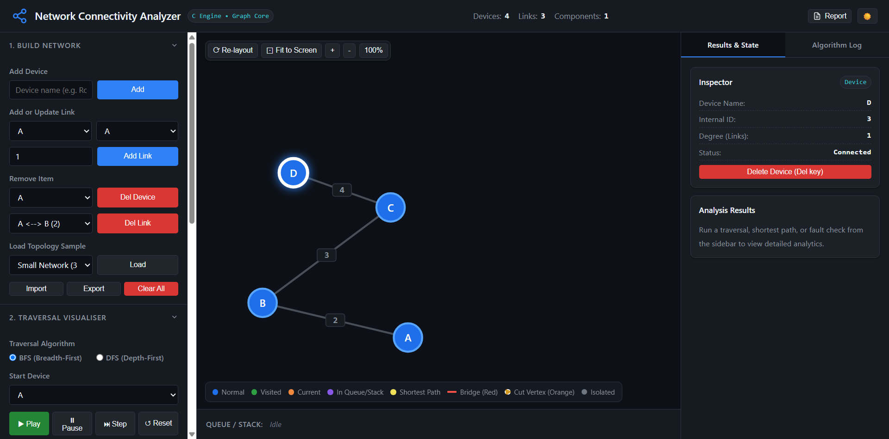
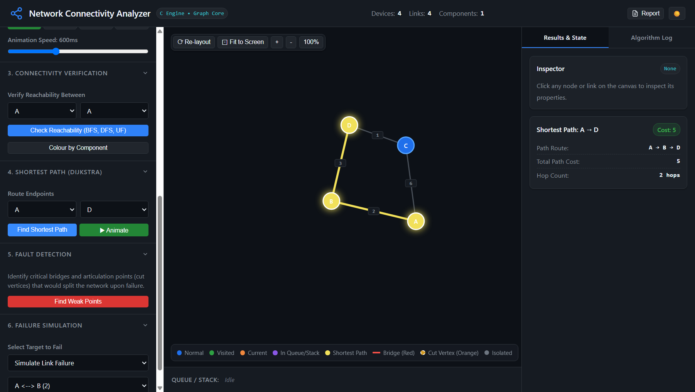
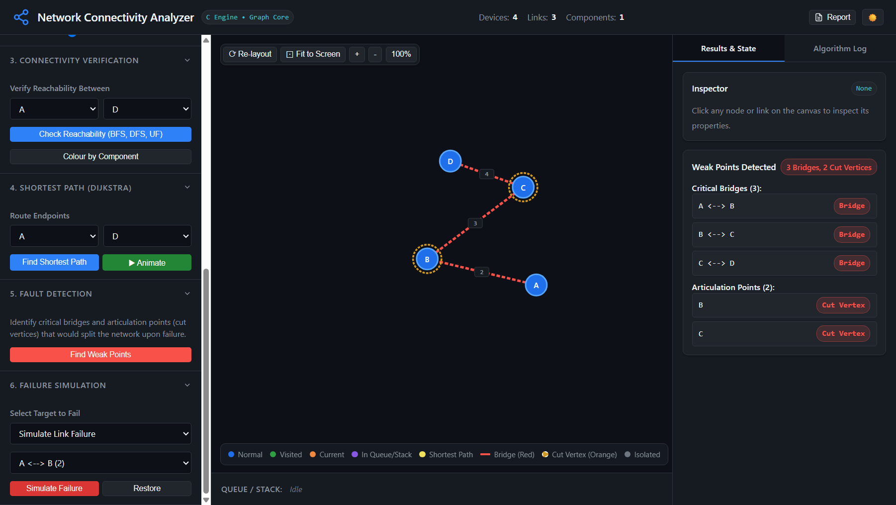
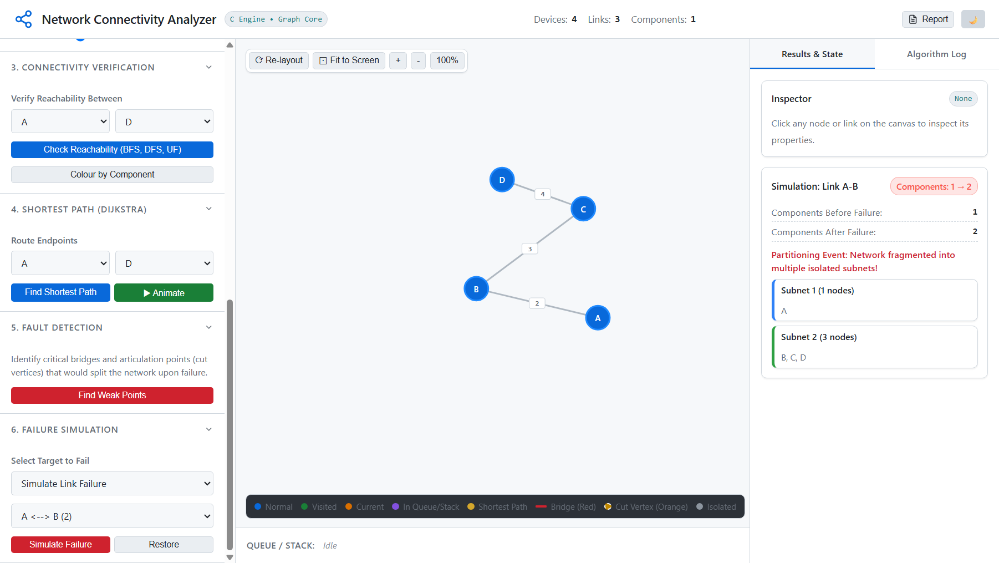

# Network Connectivity Analyzer

An enterprise-grade network topology analysis and vulnerability detection system built with strict **C11** for core graph algorithms, an asynchronous standard-library **Python 3.8+** HTTP server, and an interactive **High-DPI 2D Canvas Transit Map GUI** implemented in pure vanilla JavaScript.

Developed for **CSA0307 — Data Structures Capstone Project**  
SIMATS Engineering, Saveetha Institute of Medical and Technical Sciences.

---

## 1. System Architecture

The project strictly follows a decoupled three-tier architecture: **all algorithmic graph intelligence executes exclusively inside compiled C code**. The Python server acts as a validated subprocess bridge, and the browser provides interactive visual telemetry with zero external runtime dependencies.

```
+-------------------------------------------------------------------------+
|                         Browser Front-End (GUI)                         |
|  - Vanilla HTML5 / CSS3 / ES6 (Zero CDN, Zero npm, 100% Offline)        |
|  - Hand-written Force-Directed Physics Engine on HTML5 2D Canvas        |
|  - Drag-to-link, Pan & Zoom, Live Queue/Stack Telemetry, Dark/Light UI  |
+-------------------------------------------------------------------------+
                                    │
                         HTTP JSON REST Requests
                                    ▼
+-------------------------------------------------------------------------+
|                      Python Server (server.py)                          |
|  - Python Standard Library Only (http.server, subprocess, threading)    |
|  - Strict Input Sanitization (RegEx ^[A-Za-z0-9_-]{1,31}$, Cost 1-9999) |
|  - Auto-compiles C Binary on Startup (make / gcc fallback)              |
|  - Thread-safe In-Memory Network Model with Atomic Temp-File Exchange   |
+-------------------------------------------------------------------------+
                                    │
                         Subprocess CLI Execution
                      ./analyzer --api <cmd> <file> [args]
                                    ▼
+-------------------------------------------------------------------------+
|                         C Core Engine (analyzer)                        |
|  - Strict ISO C11 (GCC -Wall -Wextra -O2 -lm)                           |
|  - Adjacency List Graph with Alphabetical Deterministic Neighbor Order  |
|  - BFS & DFS with Step-by-Step State Snapshots (Queue & Stack)          |
|  - Disjoint Set Union (DSU) / Union-Find with Path Compression & Rank   |
|  - Dijkstra Shortest Path with Binary Min-Heap Priority Queue           |
|  - Tarjan's Bridge & Articulation Point Detection (Cut Vertices)        |
|  - Non-destructive Failure Simulation Engine                            |
+-------------------------------------------------------------------------+
```

---

## 2. Screenshots & Visual Walkthrough

| Initial Topology & Canvas (sample_small) | Dijkstra Shortest Path ($A \to B \to D$, Cost 5) |
|:---:|:---:|
|  |  |

| Vulnerability Detection: Bridges (Red) & Cut Vertices (Orange) | Modern Light Mode Theme |
|:---:|:---:|
|  |  |

---

## 3. Quick Start & Execution

### Prerequisites
- **GCC Compiler** (MinGW-W64 on Windows, or GCC on Linux/macOS)
- **GNU Make** (or `mingw32-make` on Windows)
- **Python 3.8+** (Standard Library only — no `pip install` required)

### Build & Run GUI
```bash
# Clone or navigate to the directory
cd network-analyzer

# Build C engine and start Python server automatically
make gui
```
Open your browser and navigate to: **`http://127.0.0.1:8080`**

### Run CLI Interactive Menu Mode
The original terminal CLI menu remains fully operational without flags:
```bash
# Run CLI with an optional initial file
./analyzer data/sample_small.txt
# (On Windows: analyzer.exe data/sample_small.txt)
```

### Run Automated Tests
```bash
# Run C core unit tests and Python API test suite
make test-all
```

---

## 3. C API Mode Interface

When invoked with `--api`, the binary executes exactly one command, prints a single valid JSON object to standard output, and exits with code `0` on success or code `1` on error:

```bash
./analyzer --api <command> <network_file> [args...]
```

### Command Specifications:
| Command | Arguments | Output JSON Shape | Description |
|---|---|---|---|
| `summary` | none | `{"ok":true,"devices":[...],"links":[...],"components":N,"isolated":[...],"componentList":[[...]]}` | Complete topology and connectivity summary |
| `bfs` | `<start>` | `{"ok":true,"order":[...],"levels":{...},"steps":[{"visit":"X","from":...,"queue":[...]}]}` | BFS traversal with live queue states |
| `dfs` | `<start>` | `{"ok":true,"order":[...],"levels":{...},"steps":[{"visit":"X","from":...,"stack":[...]}]}` | DFS traversal with live stack states |
| `connect` | `<x> <y>` | `{"ok":true,"bfs":true,"dfs":true,"unionfind":true,"agree":true}` | Triple-verification of path reachability |
| `path` | `<src> <dst>` | `{"ok":true,"reachable":true,"path":[...],"cost":N,"edges":[...],"steps":[{"settled":"X","dist":{...}}]}` | Dijkstra shortest path with heap settling |
| `faults` | none | `{"ok":true,"bridges":[{"a":"X","b":"Y"}],"articulation":["X",...]}` | Tarjan's bridges and cut vertices |
| `simulate-link` | `<a> <b>` | `{"ok":true,"componentsBefore":N,"componentsAfter":M,"disconnected":[[...]]}` | Non-destructive link severance |
| `simulate-device`| `<name>` | `{"ok":true,"componentsBefore":N,"componentsAfter":M,"disconnected":[[...]]}` | Non-destructive device failure |

---

## 4. HTTP REST API Endpoint Reference

All endpoints are hosted on `127.0.0.1:8080` by `server.py`:

| Method | Endpoint | Request Payload | Response / Status | Description |
|---|---|---|---|---|
| `GET` | `/` | None | `200 text/html` | Serves `web/index.html` GUI |
| `GET` | `/api/network` | None | `200 JSON` | In-memory network and C summary |
| `POST` | `/api/device` | `{"name":"A"}` | `200 JSON` / `400` | Adds device (`^[A-Za-z0-9_-]{1,31}$`) |
| `DELETE` | `/api/device/<name>`| None | `200 JSON` / `404` | Deletes device and incident links |
| `POST` | `/api/link` | `{"a":"A","b":"B","cost":5}` | `200 JSON` / `400` | Adds or updates link (Cost 1-9999) |
| `DELETE` | `/api/link` | `{"a":"A","b":"B"}` | `200 JSON` / `404` | Removes undirected link |
| `POST` | `/api/analyze/bfs` | `{"start":"A"}` | `200 JSON` / `400` | Runs BFS in C engine |
| `POST` | `/api/analyze/dfs` | `{"start":"A"}` | `200 JSON` / `400` | Runs DFS in C engine |
| `POST` | `/api/analyze/connect` | `{"x":"A","y":"B"}` | `200 JSON` / `400` | Checks BFS, DFS, and Union-Find |
| `POST` | `/api/analyze/path` | `{"src":"A","dst":"D"}` | `200 JSON` / `400` | Calculates shortest path via Dijkstra |
| `GET` | `/api/analyze/faults` | None | `200 JSON` | Detects bridges and cut vertices |
| `POST` | `/api/simulate` | `{"type":"link"\|"device",...}`| `200 JSON` / `400` | Simulates element failure |
| `POST` | `/api/load/<sample>`| None | `200 JSON` / `404` | Loads whitelisted sample (`sample_*.txt`) |
| `GET` | `/api/export` | None | `200 text/plain` | Downloads network topology `.txt` file |
| `POST` | `/api/import` | Plain text / JSON | `200 JSON` / `400` | Imports and validates network text |
| `GET` | `/api/report` | None | `200 text/plain` | Generates diagnostic plain-text report |

---

## 5. Feature Walkthrough

### 1. Build Network & Topology Management
- **Add Device / Link**: Add vertices and weighted undirected edges using sidebar forms or direct canvas gestures.
- **Canvas Gestures**:
  - *Double-click empty canvas*: Add new device.
  - *Shift + Drag from node to node*: Create a new link and prompt for weight.
  - *Click element + Delete key*: Instantly delete node or link.
  - *Drag node*: Move and pin node anywhere on canvas.
  - *Mouse wheel & Drag canvas*: Smooth zoom (0.2x to 4x) and pan.
- **Sample Presets**:
  - `sample_small.txt`: 4-node tree topology with exactly 3 bridges and 2 articulation points.
  - `sample_dijkstra.txt`: 4-node diamond graph demonstrating Dijkstra choosing $A \to B \to D$ (cost 5) over $A \to C \to D$ (cost 7).
  - `sample_disconnected.txt`: Multi-component partition ($A-B-C$, $D-E$, and isolated node $F$).
  - `sample_large.txt`: 120-node enterprise topology with core routers, distribution switches, access layers, and hosts.

### 2. Traversal Visualiser (BFS & DFS)
- Choose between Breadth-First Search (Queue) and Depth-First Search (Stack).
- Interactive **Play / Pause / Step / Reset** controls with real-time speed slider (150ms to 1500ms).
- Live visualization of the **Queue** or **Stack** rendered in animated boxes beneath the 2D canvas.
- Right-hand telemetry table showing exact node visit order and hop levels.

### 3. Connectivity Verification
- Select any two devices and verify reachability simultaneously across three distinct algorithms:
  - **BFS Search** (Queue reachability)
  - **DFS Search** (Recursive depth reachability)
  - **Disjoint Set Union** (Union-Find with path compression)
- Displays side-by-side status badges with verification whether all algorithms agree.
- **Colour by Component**: Paints each disconnected partition a distinct vibrant color and lists cluster members.

### 4. Shortest Path (Dijkstra)
- Evaluates least-cost routing using a binary min-heap priority queue ($O((V + E) \log V)$).
- **Step-by-Step Animation**: Visually settles nodes in priority order, placing real-time tentative distance badges on nodes.
- Highlights shortest path edges in glowing gold with total cost and hop count.

### 5. Fault Detection (Tarjan's Bridges & Cut Vertices)
- Implements Tarjan's low-link algorithm in $O(V + E)$ to find:
  - **Bridges**: Edges whose removal disconnects the graph (highlighted in crimson dashed lines).
  - **Articulation Points**: Nodes whose failure partitions the network (highlighted with pulsing orange rings).
- Clickable vulnerability list in the right panel centers and focuses the canvas on the selected element.

### 6. Failure Simulation
- Non-destructively simulate link severance or hardware outage.
- Failed elements fade out; resulting subnets are automatically color-coded.
- Telemetry displays exact component partitioning ($N \to M$).
- Instant "Restore" button returns the network to normal state.

### 7. Diagnostic Report & Theme Toggle
- Plain-text formatted engineering audit with device degrees, partition groups, single points of failure, and health status.
- One-click **Copy to Clipboard** and **Download (.txt)**.
- High-contrast **Dark Mode** and clean **Light Mode** toggle with persistent storage.

---

## 6. Three Live Demo Scenarios for Presentation

### Scenario 1: Interactive Network Construction & Gesture Controls
1. Click **Clear All** in the sidebar.
2. Double-click the canvas to create `Gateway`.
3. Double-click again to create `Server_1` and `Server_2`.
4. Hold **Shift** and drag a link from `Gateway` to `Server_1`, enter cost `10`.
5. Hold **Shift** and drag a link from `Gateway` to `Server_2`, enter cost `15`.
6. Click `Server_2` on canvas, observe real-time properties in the Inspector card, and press **Delete** to remove it.

### Scenario 2: Dijkstra Shortest Path vs. Greedy Routing
1. In the sidebar dropdown, select **Dijkstra Test (A-B-D Cost 5)** and click **Load**.
2. Point out that link $A \to B$ (cost 2) + $B \to D$ (cost 3) equals total cost **5**.
3. Point out that alternative link $A \to C$ (cost 6) + $C \to D$ (cost 1) equals total cost **7**.
4. In Section 4, set Source = `A`, Destination = `D`, and click **▶ Animate**.
5. Watch the C engine settle nodes in priority order, displaying distance badges on vertices.
6. Observe the final path highlight: $A \to B \to D$ with cost **5**.

### Scenario 3: Single Point of Failure (Bridge Severance)
1. In the sidebar, select **Small Network (3 Bridges)** and click **Load**.
2. In Section 5, click **Find Weak Points**.
3. Observe all 3 bridge edges highlighted in red dashed lines, and articulation points $B$ and $C$ ringed in orange.
4. In Section 6, select **Simulate Link Failure** on link `A <--> B` and click **Simulate Failure**.
5. Watch node `A` immediately split into its own isolated partition, while components increase from **1 → 2**.
6. Click **Restore** to reconnect the topology.

---

## 7. Two-Minute Presentation Script

**[0:00 - 0:25] Introduction & Architecture**
> *"Good morning respected evaluators. Today we present our Capstone project: the Network Connectivity Analyzer. Modern networks cannot afford unexpected outages. Our project models networks as graphs to audit fault tolerance, detect single points of failure, and compute optimal routes. Crucially, 100% of the graph algorithms run in a high-performance C engine written in C11. The Python middleware and modern Transit Map 2D Canvas interface only visualize results computed by C."*

**[0:25 - 0:55] Core Data Structures & Traversal Visualizer**
> *"Our C backend represents the topology using an adjacency list with dynamically sorted neighbor pointers. In Module 2, we implement BFS using a circular FIFO queue and DFS using an explicit LIFO stack. As you can see on the screen, when we click Play on the BFS visualizer, our C core streams step-by-step queue states directly into the UI. You can observe nodes turning amber as they are visited, purple when placed in the queue, and green when settled, with exact hop levels displayed in the telemetry panel."*

**[0:55 - 1:25] Dijkstra & Multi-Algorithm Verification**
> *"For routing, we implemented Dijkstra's algorithm using a binary min-heap priority queue running in $O((V+E)\log V)$ time. On our 4-node benchmark, Dijkstra dynamically settles candidate routes and chooses path A-B-D with total cost 5 rather than the greedy alternate route. Furthermore, our Connectivity module runs BFS, DFS, and Disjoint Set Union in parallel to verify reachability across all three data structures with triple agreement."*

**[1:25 - 1:55] Vulnerability Detection & Non-Destructive Failure Simulation**
> *"The hallmark feature of our system is Tarjan's Bridge and Cut Vertex detection running in $O(V+E)$ time. By computing discovery times and low-link values in a single DFS pass, the system detects critical links that lack redundancy. When we click 'Find Weak Points', our bridges highlight in red. Simulating the failure of link A-B immediately partitions the network, increasing component count from 1 to 2. Administrators can generate a full plain-text audit report with one click."*

**[1:55 - 2:00] Conclusion**
> *"Our project requires zero external libraries, zero npm packages, and runs completely offline with verified memory safety. Thank you, and we welcome your questions."*

---

## 8. Authors & Project Details

- **HARDISH M** (Reg No: 192511098)
- **HARIRAM S** (Reg No: 1965260018)
- **DINESH KARTHICK R** (Reg No: 192524121)

**Department of Computer Science & Engineering**  
SIMATS Engineering, Saveetha Institute of Medical and Technical Sciences  
Academic Year: 2026–2027
